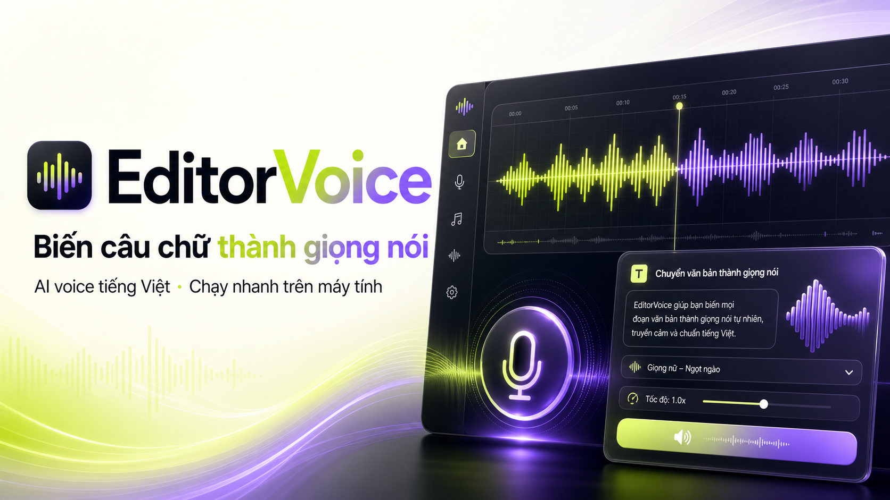

# EditorVoice



EditorVoice là ứng dụng đọc văn bản tiếng Việt và clone giọng chạy cục bộ trên
Windows. Giao diện được tối ưu cho thao tác nhanh, lịch sử âm thanh và phát trực
tiếp trong trình duyệt. Engine nền là
[VieNeu-TTS](https://github.com/pnnbao97/VieNeu-TTS), chạy ONNX INT8 trên CPU.

## Tải bản Windows

**[Tải bộ cài Windows](https://github.com/conganvinhlong02-spec/EditorVoice/releases/download/v1.2.31-unlimited/EditorVoice-Gift-Unlimited-Setup.exe)** ·
[Tải bản portable ZIP](https://github.com/conganvinhlong02-spec/EditorVoice/releases/download/v1.2.31-unlimited/EditorVoice-Gift-Unlimited.zip) ·
[Thông tin phiên bản](https://github.com/conganvinhlong02-spec/EditorVoice/releases/tag/v1.2.31-unlimited)

Bản **1.2.31 Unlimited** dành cho Windows 64-bit, không giới hạn thời gian sử
dụng. Bộ cài có sẵn Python và các thư viện cần thiết; bạn không cần cài Python
riêng. Lần chạy đầu cần Internet để tải model, các lần sau dùng lại bộ nhớ đệm.

- **Bộ cài EXE:** tải xuống và chạy để cài ứng dụng.
- **Portable ZIP:** giải nén toàn bộ thư mục rồi chạy `EditorVoice.exe`.

## Tính năng

- Tổng hợp giọng Việt 48 kHz từ văn bản.
- Giọng dựng sẵn và clone giọng từ đoạn âm thanh 3–8 giây.
- Ba phong cách đọc: tự nhiên, tin tức và kể chuyện.
- Phát trực tiếp hoặc render WAV hoàn chỉnh.
- Lưu tối đa 20 bản render gần nhất trên máy.
- Lưu hồ sơ giọng clone cục bộ để dùng lại; không lưu audio gốc.
- Bản portable và bộ cài Windows 64-bit.

## Chạy từ mã nguồn

Yêu cầu Python **3.10–3.13** (khuyến nghị **3.12**) và kết nối Internet trong lần
chạy đầu để tải thư viện và model.

Trên Windows, nhấp đúp `start_quick_studio.bat`, hoặc chạy:

```powershell
.\start_quick_studio.ps1
```

Ứng dụng mở tại `http://127.0.0.1:7860`. Các lần sau dùng lại model đã lưu trong
bộ nhớ đệm của Hugging Face.

## Sử dụng

1. Chờ trạng thái chuyển sang **Sẵn sàng**.
2. Chọn một giọng có sẵn, hoặc tải đoạn âm thanh rõ tiếng dài 3–8 giây để clone.
3. Chọn phong cách và chế độ phát trực tiếp hoặc render hoàn chỉnh.
4. Nhập nội dung, tạo giọng, sau đó nghe hoặc tải file WAV.

Các thẻ `[cười]`, `[thở dài]`, `[hắng giọng]` là tính năng thử nghiệm của engine
VieNeu-TTS v3 Turbo.

## Dữ liệu cục bộ

Khi chạy từ mã nguồn, dữ liệu ứng dụng nằm trong `.quick-studio-data/`. Bản cài
Windows lưu dữ liệu dưới `%LOCALAPPDATA%\EditorVoice`. Thư mục dữ liệu không được
đưa vào Git hoặc gói phát hành.

Chỉ clone giọng của bạn hoặc giọng mà bạn được phép sử dụng.

## Cấu hình

- `VIENEU_PORT`: đổi cổng HTTP, mặc định `7860`.
- `VIENEU_THREADS`: đặt số luồng CPU cho engine.
- `VIENEU_NO_BROWSER=1`: không tự mở trình duyệt.
- `VIENEU_APP_DATA_DIR`: đổi thư mục dữ liệu ứng dụng.

## Đóng gói Windows

Tạo bản portable và bộ cài có giới hạn thời gian:

```powershell
.\build_windows_portable.ps1
.\build_windows_installer.ps1
```

Tạo bản quà tặng không kiểm tra ngày hết hạn:

```powershell
.\build_windows_portable.ps1 -Unlimited
.\build_windows_installer.ps1 -Unlimited
```

Kết quả nằm trong thư mục `dist/`.

## Kiểm thử

```powershell
.\.venv\Scripts\python.exe -m pytest
```

## Nền tảng và giấy phép

EditorVoice sử dụng VieNeu-TTS làm engine tổng hợp giọng nói. Mã nguồn engine và
các thành phần trong repository tiếp tục tuân theo giấy phép Apache 2.0 trong
file [LICENSE](LICENSE).
